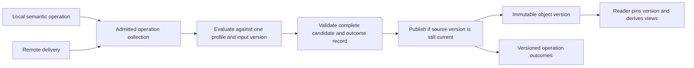

# Designing Mergeable Shared State with DAC

Two people edit a running application's objects while disconnected. When their work is
reconciled, the application must retain meaningful operations and expose valid objects.
Agreement between replicas is one requirement. A usable construction must also account for
relationships between objects, concurrent readers, rejected work, and changes to earlier results.

This case study uses Domain Abstraction Collapse (DAC) to develop a solution to that problem.
The result is a structural design, a selected conflict policy, a catalog selection, and a small
executable exploration. It is a design study dated September 7, 2026; the executable checks
cover the finite profile in Section 8.

## 1. Use DAC to design the solution

DAC has two uses. Both start with the work in its own terms and strip domain content before
selecting structures.

| Use | Starting point | Required result |
|---|---|---|
| Discover and compare structures | Existing systems and their implementations | Shared constructions, recurring responsibilities, and residuals that can revise the catalog |
| Solve a problem | Required behavior, constraints, and possible failures | Structural requirements and obligations, followed by a design whose selected parts can fulfill them |

This study uses the second. Its stopping condition is a buildable design with traceable
responsibilities and explicit unresolved requirements. The implementation experiment must
mechanically assemble that design from the canonical structures. This assembly is part of the
claim under test: the structures must supply the governed behavior, rather than merely describe
a separately written solution. Finding an ultimately irreducible set of parts is a separate
research question. The method's
[problem-first construction](../../domain-abstraction-collapse.md#13-problem-first-construction-and-reconstruction)
already distinguishes design adequacy from implementation conformance.

The working sequence is the five-step DAC procedure: freeze the problem territory, describe the
work in its own terms, strip domain content, classify the structural requirements, and construct
and test a proposed solution. Related mechanisms enter after the requirements have been derived.
Catalog selection follows in Section 7.

## 2. Freeze and describe the problem

### Source and boundary

Ink & Switch's [Convergence Is Not Enough](https://www.inkandswitch.com/livelymerge/notebook/lm-02/)
describes a shared application heap whose replicas agree after merging, although relationships
inside the heap can become invalid. Its examples include linked structures and dependent views.
The authors consider operations defined at the abstract type's boundary, deterministic replay,
and refusal of invalid merges. They identify programmer support for checking operation
commutativity or conflict resolution as an open question, and note that replay can revise an
earlier accepted result.

The requirements and design below are this study's response. They are not attributed to Ink &
Switch. The working target is a collection of programmer-defined objects with declared operations
and relationships. Unrestricted mutation of arbitrary executable heap state is outside the
initial implementation profile; such code must first expose the semantics and mutation boundary
on which the construction depends.

The design admits local editing while communication is unavailable. It distinguishes an edit's
provisional local outcome from a stable commitment. It permits temporary divergence during
incomplete delivery and requires agreement for equivalent complete inputs under one semantic
profile. A request that cannot be fulfilled must receive a declared outcome rather than disappear.

For the first executable profile, freeze a rooted tree of four existing nodes, two replicas, and
reparenting operations. Node creation, deletion, arbitrary methods, and irreversible effects remain
requirements for later profiles. This small profile exercises concurrent interference across
relationships without requiring a complete programming environment.

### Native problem record

| Field | Problem description before catalog selection |
|---|---|
| Actors | Editors issue operations; replicas retain changes; application code reads objects; transport delivers remote work; type authors define permitted behavior. |
| State | Objects and their identities, relationships, locally known operations, causal context, visible object versions, and operation outcomes. |
| Local edit | Read a local version, request an operation, compute its result, and expose a provisional outcome. |
| Remote edit | Receive an operation or state containing operations, establish its interpretation, and reconcile it with local work. |
| Publication | Make a complete resulting object version and its corresponding outcome record visible. |
| Observation | Read an object and related views, inspect an operation's outcome, or observe that a previous outcome changed. |
| Interference | Another local operation or remote arrival can change the relevant state between observation, computation, validation, and publication. |
| Failures to handle initially | Delayed, duplicate, and reordered delivery; conflicting concurrent edits; incomplete causal input; and stale local computation. |
| Environmental assumptions | Nonfaulty replicas, intact operation content, stable type definitions, eventual delivery for eventual agreement, and an adequate local atomic publication mechanism. |
| Later operational requirements | Crash recovery, finite storage, safe reclamation, type evolution, membership change, and externally executed effects. |

An object field named `owner` can mean its parent in a containment hierarchy. That field must not
be confused with the enforcement owner of an engineering obligation.

The source list counterexample supplies the first negative witness. Both local changes leave a
valid list. Applying their stored writes in either transaction order yields an invalid result.
Our executable reproduction records termination after `1, 3` in one order and a cycle in the
other. This is a test of the stated write model, not an execution of Automerge.

## 3. Strip domain content without losing the problem

Replace objects, pointers, and editing vocabulary with structural roles. Retain the behavior
that an implementation must account for.

| Domain description | Structural requirement that remains |
|---|---|
| An editor sees a local heap | A participant observes one version of a subject. |
| An edit computes several writes | A requested transition produces a candidate effect relative to an observed state. |
| Another editor changes related objects | Independent transitions can interfere through shared predicates, including when their write targets differ. |
| Changes arrive later | New evidence can invalidate assumptions used by an earlier computation. |
| Object pointers, indexes, and child lists must agree | Several observations must correspond to one governed relationship or source state. |
| A merged list or tree must remain usable | Publication must preserve the declared relation over the complete affected subject. |
| Replicas must agree | Equivalent relevant inputs must produce equivalent observable results under shared semantics. |
| Previously accepted work may change | The construction needs an explicit rule for revision, status, and any dependent work. |

Let `S` be a subject state, `I(S)` its validity predicate, and `W_a` and `W_b` prepared effects.
Both `I(W_a(S))` and `I(W_b(S))` can hold while `I(W_b(W_a(S)))` fails. An effect computed from an
earlier observation is not interchangeable with recomputing the requested operation against the
current state. The design must preserve that distinction.

The stripped requirements have different failure conditions. A system can agree on an invalid
result. It can retain valid local results indefinitely without reaching agreement. It can produce
a valid shared result after discarding meaningful work. It can fulfill all those state-based
conditions while violating a promise that an earlier acceptance would remain effective.

The mathematical predicates describe fulfillment. The obligation is the engineering
responsibility accepted by the implementation or protocol that controls the relevant behavior.

### Separate source correspondence from source validity

Some apparent mutable-state problems disappear when one representation becomes a derived view.
Store one parent relation and derive the child collections. Compute a count from its collection
when retaining a second mutable count offers no required benefit.

This removes one opportunity for disagreement. It does not make the source relation valid.
Opposing reparenting operations can create a cycle even when every child view agrees exactly with
the parent relation. Source validity and view correspondence therefore remain separate
requirements. If a cached view is retained, its maintenance and observation rules become part of
the design rather than an incidental optimization.

## 4. State the obligations and required structural behavior

The following obligations define the proposed solution. Core obligations apply to the initial
design. Extension obligations name work required before making broader operational promises.
The identifiers support traceability; they do not propose new catalog entries.

| ID | Obligation | Decisive failure | Required structural behavior |
|---|---|---|---|
| O1 | Preserve operation identity and content. | One identity resolves to two operations, or delivery invents a new edit. | Admit identities under a content-binding rule and recognize duplicates. |
| O2 | Preserve the required causal context. | An operation runs before information its interpretation requires. | Retain dependencies and defer incomplete work under an explicit readiness rule. |
| O3 | Interpret operations according to the selected type contract. | Stored writes or an arbitrary winner substitute for the declared operation semantics. | Bind each operation to a semantic profile and its permitted outcomes. |
| O4 | Expose only valid object states. | An invalid candidate becomes visible. | Evaluate and enforce validity at the publication boundary. |
| O5 | Preserve relationships across object boundaries. | Each part passes its local checks while their combined relation fails. | Declare the full invariant scope and govern every transition that can affect it. |
| O6 | Produce equivalent results from equivalent complete inputs. | Delivery order or local nondeterminism changes the result. | Supply a justified merge law or deterministic reconciliation policy. |
| O7 | Account for all admitted source operations. | Agreement hides a lost operation or missing outcome. | Distinguish received, pending, applied, and rejected work; compare against the relevant admitted input set. |
| O8 | Give each read a coherent object version. | One read combines fields or views from different publications. | Pin one version for the declared read scope. |
| O9 | Bind validation to the candidate and context used at commit. | A checked result is published after its source or policy changed. | Revalidate or reject stale publication under a version or equivalent authority check. |
| O10 | Publish the complete governed result. | A reader sees a partial effect batch or an outcome record for another version. | Commit the state, input identity, profile, and outcome record at one observation boundary. |
| O11 | Complete processing under the declared progress assumptions. | Admitted ready work is ignored indefinitely. | Separate finite evaluation, scheduling, and eventual delivery premises; expose work still waiting. |
| O12 | State and preserve the meaning of acceptance. | Provisional execution is reported as irreversible success, or revision is hidden. | Version outcomes and publish changes to earlier outcomes. |
| O13 | Govern external effects separately from replay. | Re-execution duplicates an effect, or rollback claims to undo an irreversible action. | Require an appropriate commitment and effect protocol before dispatch; make its guarantees explicit. |
| O14 | Reclaim only state and history no admitted observer or operation still needs. | A reader uses reclaimed state, or late work needs discarded causal history. | Establish separate local reader-lifetime and distributed history-retention conditions. |
| O15 | Preserve interpretation across type and schema changes. | Replicas replay the same event under incompatible meanings. | Bind type and policy versions; require an explicit migration or compatibility protocol. |
| O16 | Preserve accepted-work custody under claimed failures and storage limits. | An acknowledged edit is lost on restart or silently evicted under pressure. | Define durability, admission, backpressure, and recovery before issuing those guarantees. |

O13 through O16 are operational extensions. The first profile freezes the semantics and retains
its finite input in memory. It makes no durable-acceptance, reclamation, migration, or external-effect
claim. O8 through O10 remain local-runtime implementation requirements beyond the pure evaluator.

For a shared predicate `I(S1, S2)`, two independent local guards are insufficient unless their
composition preserves that predicate. The responsible boundary may encompass several objects.
The scope follows the condition that can fail, rather than the shape of the object API.

### Route the material into DAC's construction strata

| Stratum | Material in this design |
|---|---|
| Domain parameters | Operation meanings, validity predicates, conflict policy, equivalence relation, representation functions, and profile-specific causal requirements. |
| Runtime relies | Atomic publication, safe reader references, transport, scheduling, storage, and any protocol supplying stable commitment. |
| Connective occurrences | Pending collections, ordering computations, carried intermediate states, positions, and derived views where no additional guarantee is claimed. |
| Governed structures and compositions | Identity admission, exact input/result binding, relationship maintenance, publication control, coherent observation, and outcome revision under the chosen contract. |

The distinction prevents two errors. A predicate supplied as domain content still needs an
enforcement boundary. A buffer used to hold operations still needs a supplier for any durability,
capacity, or delivery claim. This study identifies those required structures without requiring
each one to receive a new primitive classification.

## 5. Borrow mechanisms from other shared-state systems

Memory management addresses several pieces of this problem. Its most useful contributions
concern which version a reader can observe, who may mutate it, and when storage can be reclaimed.
Those mechanisms can support the local implementation while a replication protocol handles
independent edits.

The transfer column below is a design inference from the cited mechanism.

| Existing mechanism | Established behavior | Transfer to this problem and its limit |
|---|---|---|
| [Rust borrowing](https://doc.rust-lang.org/book/ch04-02-references-and-borrowing.html) | Safe references constrain conflicting access and dangling references. | Restrict mutation of governed state to a controlled API; immutable published versions simplify read access. Memory safety alone does not establish application invariants or reconcile disconnected writers. |
| [Read-copy update](https://docs.kernel.org/RCU/whatisRCU.html) | RCU separates removing or replacing access to data from reclaiming it after earlier readers finish. | Build a replacement privately and retain old versions for readers. For coherent multi-object reads, use a suitable immutable snapshot and pin its root. RCU alone does not supply arbitrary snapshot consistency or resolve concurrent writers. |
| [MVCC and serializable transactions](https://www.postgresql.org/docs/18/transaction-iso.html) | PostgreSQL separates snapshot-based isolation from Serializable execution, which can reject transactions that cannot fit a serial execution. | Treat observations and publication as one transaction-sized concern. A stable snapshot alone does not prevent every cross-object anomaly. A single transactional authority cannot give disconnected participants unrestricted immediate commits. |
| [Software transactional memory](https://clojure.org/reference/refs) | Clojure transactions coordinate changes to references; retries and validators affect how transaction code must be written. | Keep speculative computation separate from publication and external effects. Retry semantic work under the selected local protocol. STM does not define the outcome of arbitrary offline conflicts. |
| [Replicated tree algorithms](https://martin.kleppmann.com/2021/10/07/crdt-tree-move-operation.html) | Kleppmann and colleagues give a formally verified tree-move algorithm preserving tree validity and convergence without synchronous coordination. | Reuse an established operation-specific protocol when its semantics fit. The required tree behavior already has a direct donor; DAC does not need to invent it. |
| [Escrow and bounded counters](https://arxiv.org/abs/1503.09052) | Balegas and colleagues adapt escrow to maintain numeric invariants in an eventually consistent replicated datatype. | Preallocated rights can support local admission within a distributed bound. Transferring or replenishing rights needs its own protocol. This does not make arbitrary relationship constraints independent. |
| [Invariant confluence](https://www.vldb.org/pvldb/vol8/p185-bailis.pdf) | Bailis and colleagues characterize coordination requirements under a model of transactions, invariants, availability, and convergence. | Analyze the chosen semantics and merge before promising independent commitment. Changing the rejection or revision policy changes the problem being analyzed. |
| [VeriFx](https://drops.dagstuhl.de/entities/document/10.4230/DARTS.9.2.19) and [EFx](https://onlinelibrary.wiley.com/doi/10.1002/spe.3430) | These projects supply verification support for replicated datatypes; EFx combines concurrency contracts with analysis of implementations. | Use existing verification techniques for the domain laws. DAC contributes the requirements and construction account; custom-type verification is established neighboring work. |

Memory reclamation supplies a useful distinction for history retention. Locally, an old version
can be retired after the applicable readers finish. In a replicated construction, absence of local
readers says nothing about a disconnected participant's future operation. Dropping history needs
a protocol establishing that future admitted work cannot require it, or a resynchronization rule
that explicitly excludes such work. The first profile retains all history rather than claiming
that a local grace period establishes distributed safety.

The research already contains an [optimistic STM reconstruction](../../../formal/examples/case-studies/optimistic-stm/README.md)
and a [finite replicated JSON reconstruction](../../../formal/examples/case-studies/state-based-json-crdt/README.md).
They are useful donors for local publication and replication premise binding, respectively.
Their documented evidence does not establish this new composition.

## 6. The solution that takes shape

### Choose semantics before mechanisms

The obligations permit several designs. Select a policy for each declared operation family and
its composition scope.

| Policy | What it permits | Additional responsibility |
|---|---|---|
| Merge with established laws | Independent operations whose merge preserves the declared semantics | Bind the actual operator and inputs to those laws. |
| Deterministic replay with explicit rejection | Responsive provisional editing with later reconciliation | Account for rejected operations and changes to prior outcomes. |
| Refuse the merge pending repair | Preserve a valid local state when reconciliation is unresolved | Expose divergence and provide a repair process; refusal alone does not supply eventual agreement. |
| Coordinate commitment or allocate exclusive rights | Stronger commitment for operations requiring controlled interference | Supply the authority, availability conditions, and failure behavior of that protocol. |

The initial tree profile selects deterministic replay with explicit rejection. This is a
deliberate contract choice: local success is provisional. Existing specialized replicated types
can replace the replay evaluator when they preserve the same advertised contract or expose a
clearly selected alternative. Stable external commitment belongs to a separate profile.

### Retain semantic operations and publish immutable versions

The proposed per-replica construction retains immutable semantic operation records. A record
contains an identity, type/profile version, subject, arguments, ordering information, and required
causal context. A duplicate record retains one identity. Conflicting content under one identity
is a protocol violation; the initial failure model assumes nonfaulty sources.

An evaluator constructs a new object version privately. Publication exposes one version record
containing the object root, relevant input identities, semantic profile, and operation outcomes.
A reader pins that record for its declared read scope and derives dependent views from it.



This is a local construction at each replica. It does not impose one global execution authority.
The replication protocol supplies the relation between replicas; the local runtime supplies the
observation and publication boundary.

### Give type authors an explicit contract

The programmer-facing unit is a type module with enough information to construct and check its
transitions. An initial module interface should require the following records.

| Record | Required content |
|---|---|
| State and observation | A valid initial state, representation, abstract view, and equivalence relation. |
| Operations | Arguments, target identities, preconditions, transition semantics, and permitted outcomes. |
| Relationships | The validity predicates and the complete object scope over which they must hold. |
| Concurrency | Required causal context, semantic prerequisites, and the selected merge or reconciliation policy. |
| Execution conditions | Determinism, termination conditions, controlled mutation paths, and separation of replay from external effects. |
| Evidence | Operation-preservation checks, concurrent counterexamples, composition checks, and the implementation/profile to which those results apply. |

The development workflow can generate finite conflicting histories and report the operation pair,
relationship, and transition that fails. Existing verification tools can establish stronger laws
for supported programs. A failed check sends the author back to the operation semantics,
composition scope, or conflict policy. It must not silently weaken the advertised obligation.
Finite checks remain evidence at their stated bounds; the interface does not promise to decide
arbitrary program correctness.

### Define the first operation contract

The domain state is a parent map with one root and a fixed set of nodes. Every non-root node has
exactly one parent, all parents exist, and every parent path reaches the root. Child collections
are derived. Their presentation order is deterministic and carries no user-controlled ordering
semantics in this profile.

The operation is `reparent(child, new_parent)`. Against the current replay state it replaces the
child's previous parent, provided the result remains a rooted tree. A rejected operation leaves
the tree unchanged. It remains in the input and outcome records. Moving a node to its current
parent is an allowed no-op.

These semantics distinguish an applied operation from a permanently retained field value. A
later valid operation can overwrite an earlier placement. An outcome of `applied` means that the
operation took effect at its position in the selected replay; it does not promise permanent
ownership of that field.

Order operations by a logical counter and replica identity, with the order extending causal
dependencies. Real clocks are unnecessary. The complete distributed implementation must enforce
fresh identities and the counter/dependency rule. The finite evaluator receives explicit records
and checks their ordering premise.

### Reconcile and publish

1. Admit an operation under its identity and profile. Preserve its arguments and causal context.
2. Capture the current operation collection and local input-generation value.
3. Defer operations whose required causal records are missing. For ready records, compute the
   agreed order independently of delivery order.
4. Replay from the shared valid base. Compute each semantic operation against the current replay
   state. Apply a valid candidate or record a rejection without changing that state.
5. Derive the complete object view and outcomes. Check source-operation accounting separately
   from final object equality.
6. Publish the candidate only if its captured generation and profile still match. A concurrent
   local edit or remote arrival makes a stale candidate ineligible; recompute without overwriting
   the newer input.
7. Make the state root, input identity, profile, and outcomes visible together. Publish outcome
   revisions when earlier provisional work changes status.
8. Retain old immutable versions until the local lifetime mechanism permits reclamation. Retain
   operation history until a separate distributed retention rule permits discarding it.

The generation comparison and publication must share an atomic or equivalent serialized
boundary. A check followed by an unprotected root assignment leaves O9 open. Every mutation path,
including remote receipt, must participate in the same generation discipline. A coherent read
also needs a pinned version; independently loading several current roots is insufficient.

A candidate runtime realization inside the reusable publication composition can use a mutex
around the admitted-operation collection, generation, profile, and current snapshot handle.
The composition must obtain its governed state and transitions from the selected canonical
structures. Under that mutex, a worker captures
its inputs; it computes outside the mutex; it reacquires the mutex to check the generation and
replace the complete snapshot handle. Receiving a new operation changes the generation under the
same mutex. Generation identifiers must not wrap or be reused while a candidate can still refer
to them.

A reader acquires the mutex long enough to clone a reference to the current immutable snapshot,
then reads through that reference after releasing the mutex. In Rust, an `Arc<Snapshot>` can keep
that version alive. The snapshot contains identifiers and immutable records, with no interior
mutation of published state. This combines the standard
[Mutex](https://doc.rust-lang.org/std/sync/struct.Mutex.html) exclusion contract and
[Arc](https://doc.rust-lang.org/std/sync/struct.Arc.html) lifetime mechanism in a proposed local
publication protocol. It needs its own implementation checks. RCU is an alternative worth
considering if measured reader contention justifies a different realization.

The mutex and reference counting supply runtime exclusion and lifetime services. They do not
replace the structural contracts for identity, admission, publication, or completion. The PoC
consumes the assembled publication composition; it must not acquire another implementation of
those responsibilities in a local snapshot manager.

Causal dependency and semantic prerequisite are different. Observing an earlier operation
requires ordering after it, but does not necessarily require that operation to succeed. The
first profile has fixed identities and no semantic prerequisites. A later profile with object
creation must specify what happens when an edit refers to a creation that is rejected, including
whether the dependent edit waits, is rejected, or is reinterpreted.

### Explain the conditional behavior

For a finite complete operation set `E`, fixed valid base `S0`, and shared semantic profile `P`,
let `Evaluate(P, S0, E)` return the state and outcome map.

If the selected order, operation interpretation, and validity checks are deterministic and
terminate, equal inputs produce equal results. If each applied transition preserves validity
and each rejected transition leaves the state unchanged, induction over the replay gives a valid
result. If publication exposes only that complete validated result, readers of its pinned version
observe the governed state and corresponding outcomes.

These are conditional design arguments. Eventual agreement also needs complete delivery and
processing, with quiescence for the finite-set statement. The result does not establish arbitrary
program termination, durable custody, or general implementation conformance. A rejected operation
remains part of `E`; otherwise equal final trees could conceal missing work.

### Treat acceptance as part of the interface

Expose at least the operation identity, publication version, semantic profile, outcome, and any
rejection reason. A dependent operation may be pending. An outcome in a published version can be
applied or rejected. The interface must state that these outcomes are provisional under further
reconciliation.

For example, a move placing B beneath A can be provisionally applied. A late earlier-ordered move
placing A beneath B can cause replay to reject B's move. Both replicas can then expose a valid
common tree. The construction must report the revision; it cannot retain an irrevocable-success
claim for B's earlier outcome.

Do not execute external effects inside replay. A separate protocol must determine when an effect
is authorized, how retries are identified, and what acknowledgment establishes. Idempotency can
address duplicate execution under its own contract; it does not establish that an effect was
semantically authorized. A timeout or silence from other replicas does not establish finality
without an additional protocol premise.

## 7. Select structures after deriving their work

The [catalog](../../reference.md) can now be consulted against the required behavior. The selections
below describe a proposed construction. The executable exploration in Section 8 tests domain
semantics and policies; it does not call these Rust structures.

The solution must assemble from the structures. Each governed responsibility must be fulfilled
through its canonical implementation or an explicit composition of canonical implementations.
Domain code supplies operation semantics, predicates, values, and policy. Runtime providers
supply services such as atomicity, storage, and transport. Neither boundary can hide a second
registry, reducer, queue, scheduler, admission lifecycle, or commit owner.

Mechanical assembly means selecting component instances and supported modes, setting parameters,
connecting their inputs and outputs, binding required shared transitions, and supplying the
declared domain functions and providers. Canonical component implementations must supply the
governed transitions required by their contracts. Giving handwritten protocol code a composition
name does not meet this condition.
Handwritten Rust wiring is permissible; independently generated structural behavior is not.

For each obligation, the implementation record must identify the selected composition, the
actual component instances and calls, its domain parameters, provider relies, and the control
that detects bypass of the responsible component or connection. Passing a domain-level outcome
check alone does not establish that the solution was assembled from the structures.

The controls must establish that those components govern the outcome. Calling a structure only
to record work already decided elsewhere is insufficient. Hold the domain calculation fixed,
bypass the selected enforcement or break its connection, and exercise the corresponding
falsifying transition. Check action correspondence and the claimed obligation as well as the
presence of component calls.

| Required work | Selected structure or mechanism | Obligation coverage and remaining binding |
|---|---|---|
| Admit stable subject, operation, and version identities | `ResourceRegistry` | Supports O1 and the identity portion of O7/O15. Distributed uniqueness, complete causal content, and profile compatibility remain protocol responsibilities. |
| Account for ordered consumed operations and computed replay result | `Reduction` with the selected semantic evaluator | Supplies input/prefix/result accounting for O3/O6/O7. The replay evaluator's laws and rejection semantics need their own argument. The current verified additive Rust profile is not a ready-made arbitrary replay implementation. |
| Represent governed relationships | A parent record under `ResourceRegistry`; `RelationshipGraph` where its edge model matches the selected representation | Supports relationship identity and derived adjacency. Rootedness, one-parent semantics, and acyclicity remain explicit domain and composition conditions for O4/O5. |
| Bind the selected effect batch to the intended subject | `ActuationPass` | Supports effect-target and completion accounting for O9/O10. External effect execution and atomic snapshot publication require the corresponding runtime binding. |
| Order local processing and completion | `Sequential` for each governed local transition | Supplies local order. It neither creates cross-replica causal order nor proves distributed agreement. |
| Carry pending work and derive observations | Buffer, Marker, Counter, OrderingPass, Accumulator, and Projection connective occurrences | Supply the stated joining roles. Any claimed delivery, stable order, lifetime, or freshness guarantee must land on the surrounding protocol or runtime contract. |
| Deliver changes in operation outcomes | `Signal`, if subscriptions are part of the implementation | Supports the selected notification contract for O12. Notifications must name the publication version and the operation whose status changed. |
| Govern storage or processing limits in an operational profile | `Budget` and a declared admission/backpressure policy | Supports local ceilings for O16. It cannot silently discard accepted operations or supply a distributed escrow protocol merely by naming local budgets. |

The local publication and reconciliation protocols are required structural parts of the design.
Construct them through the canonical structures and their declared composition rules. A required
composition can be added without first establishing primitive status. If the available executable
profiles cannot supply a required behavior, first examine the possible compositions and record
the exact gap. Extend the appropriate canonical owner and its evidence before consuming that
capability. A gap does not authorize a replacement implementation inside the PoC.

First test assembly with the available structures. An unresolved gap is a result of that test;
it must remain visible. If a canonical extension is later required, record the changed component
set and repeat the affected assembly checks. Do not credit the extended result as evidence that
the original set already supplied the missing behavior.

Do not select `ConvergenceGovernor` just because the problem uses the word convergence. This
profile relies on operation semantics, input completeness, and delivery. It has no governed
fixed-point iteration requiring that catalog contract. Likewise, asynchronous receipt does not
have the common round snapshot and coverage contract of `PropagationPass`.

A single global `AuditSink` chain would introduce an order the source events did not originally
have. Local publication evidence may use a chain under an appropriate contract. Operation
causality and deterministic replay order still need their separate representations and meaning.

### Place responsibility at the decisive boundaries

| Claim frame | Required controlling boundary | External relies |
|---|---|---|
| One replica exposes valid coherent versions | Local publication mechanism covering all governed mutation and read paths | Memory ordering, object lifetime, and the correctness of the supplied predicates/evaluator |
| Replicas agree under the selected semantic profile | Named replication protocol covering identity, admissible inputs, ordering, evaluation, and observation | Nonfaulty participants, eventual delivery/processing, and shared configuration |
| A type operation has the declared meaning | Admitted type implementation and its complete semantic contract | Any called behavior outside that boundary |
| An external effect is stably authorized and correctly performed | The selected commitment and effect protocol at its stated claim frame | Independently controlled effect providers and their assurance evidence |

These are required authority boundaries. A deployed system must establish that the selected
principal or named protocol controls all decisive behavior before issuing its guarantee. Calling
a library does not establish that authority. The
[ownership model](../../claim-relative-ownership.md) supplies the distinction between an owned
guarantee and assurance about another boundary.

For `alk-core`, this suggests a governed reconciliation component plus a local publication
boundary assembled through the common structure library. Kernel admission should bind the
semantic profile, execution paths, and relies. Current kernel integration and conformance are
implementation work, not results of this design study.

## 8. Exercise the design and its failure conditions

The accompanying [exploration](explore.py) evaluates the fixed-node tree profile and reproduces
the source list witness. Its [recorded output](results.json) includes the script's SHA-256.
It is a pure domain model, with no alternative implementation of a catalog structure.

The tree enumeration includes every rooted parent map over `root`, `A`, `B`, and `C`. For each
valid starting tree it chooses every pair of individually valid non-root reparentings, including
allowed no-ops. The events have distinct identities, a common base, and no causal dependencies.

Each pair runs through four delivery scenarios: A then B, B then A, A then B with duplicate A,
and B then A with duplicate B. Both replay prefixes and partial delivered sets are checked for
validity. Full results compare tree, operation outcomes, and input identities.

| Measurement | Result |
|---|---:|
| Valid initial trees | 16 |
| Locally valid operation pairs | 828 |
| Delivery scenarios | 3,312 |
| Replay-prefix validity checks | 6,624 |
| Rejected operations across the canonical pair runs | 48 |

These counts describe one finite enumeration, not independent proofs or a sample of arbitrary
programs. The 48 rejected operations also show that the preservation check exercises rejection.

The candidate validity predicate follows parent paths. A separate reference expands the set of
nodes reachable from the root. They share the parent-map representation but do not share the
validity algorithm. This reference checks the state invariant; it is not an independent oracle
for every aspect of the replay policy or user intent.

| Discriminating control | Required observation | Observed result |
|---|---|---|
| Reapply stale source-list writes | Local validity must not excuse invalid combined state | Both transaction orders produce the expected invalid list. |
| Replay in arrival order | Validity must not substitute for agreement | Two valid final trees differ. |
| Check the pre-state instead of the candidate | The check must bind the published result | A cycle escapes. |
| Drop an issued operation | Final state equality must not substitute for input/outcome accounting | The tree can remain identical while the input and outcome records differ. |
| Reuse an identity for different content | Identity admission must bind meaning | The evaluator rejects the conflicting record. |
| Derive inverse views without checking the source relation | View correspondence must not substitute for source validity | Consistent views still describe a cycle. |
| Merge a collection and count independently | A local summary must not stand in for a joined relation | The collection has two elements and its retained count is one. |

Named witnesses also check a missing causal dependency, late revision of an earlier outcome,
and the valid-but-divergent result of refusing a conflict. The causal witness is separate from
the enumeration: it contains two ordered events and delays the prerequisite.

Run with Python 3.10 or later from this directory:

```sh
python explore.py
```

To write a fresh result record after an intentional source change:

```sh
python explore.py --output results.json
```

Assertions are required; the script rejects execution with Python optimization enabled. The
experiment does not model actual concurrent memory access, transport implementation, durable
storage, reclamation, type evolution, external effects, or canonical Rust structure bindings.
No TLA+ or Verus result is claimed for this case study.

## 9. Build the next implementation from these requirements

The first implementation should expose the fixed-node tree contract, provisional outcomes, and
coherent immutable versions through an assembly of canonical structures. Existing tree protocols
can supply domain algorithms and behavioral references when their exact semantics fit. Their
governed behavior must still be accounted for by the assembly. Retain the simple evaluator as an
explanatory reference rather than treating full replay as a performance requirement.

| Work item | Acceptance condition |
|---|---|
| Freeze the mechanical assembly recipe | Every obligation has a selected canonical component or composition, parameters, connections, and provider bindings; any unsupported structural behavior remains an explicit gap. |
| Bind the domain protocol to canonical structure implementations | Every admitted event, consumed operation, effect target, and completion maps to the selected contract without duplicate structure implementations. |
| Assemble the local publication boundary | Canonical component instances govern the state and transitions; a competing local edit or remote receipt cannot publish a stale candidate or cause a read to combine versions. Include controls that bypass a component and the generation check. |
| Make outcomes part of the public interface | Late reconciliation reports the affected operation and version; applied, rejected, and pending remain distinguishable from stable commitment. |
| Add another operation family | Declare creation/deletion and anchor semantics before adding code; account for missing targets, semantic prerequisites, and any cross-type invariants. |
| Assemble operational guarantees | Select canonical structures and compositions for custody, backpressure, restart, reclamation, and external effects; bind the necessary providers and evidence before advertising those guarantees. |
| Compare against a separate behavioral reference | Check operation semantics, outcomes, complete inputs, and observations across bounded concurrent schedules, not only final state validity. |

The useful outcome of this DAC pass is the set of design decisions it makes reviewable: a
semantic operation boundary, explicit composition scope, separate reconciliation and local
publication, derived views, versioned provisional outcomes, and a distinct protocol for stronger
commitment. The next experiment should challenge those decisions at their implementation
boundaries rather than reopen primitive minimality.
